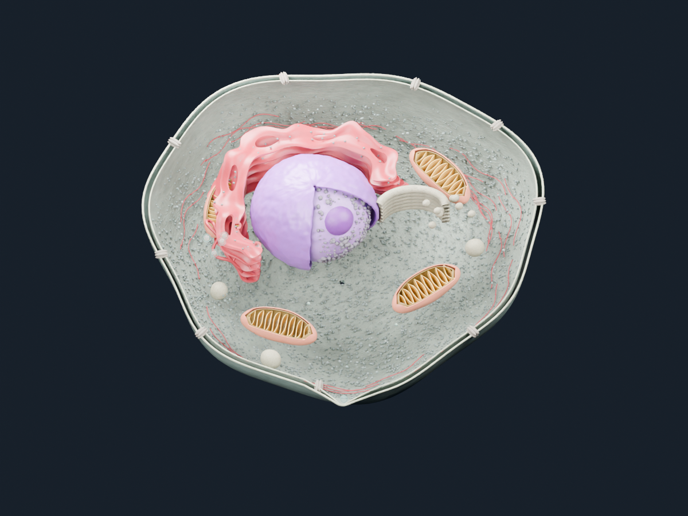

# Alchemistry Blender assets

Three independently editable snapshots exported from the latest Alchemistry film, using Blender 5.2 LTS.

| File | Contents |
| --- | --- |
| `assets/Cell_environment.blend` | Entire cutaway cell in one wide camera view. Membrane, nucleus, red ER, mitochondria with cristae, Golgi, ribosomes, replication site and molecular actors remain separate editable objects. Frozen at intracellular frame 797. |
| `assets/2R6P_ensemble.blend` | Actual complete 2R6P molecular assembly from the movie, with a separate packaged RNA mesh. No transport vesicle or red fill. |
| `assets/6MO0_protease.blend` | Folded 6MO0 ribbon and separate JVJ ligand in its deposited bound pose. |



## Open and edit

Clone with **GitHub Desktop**, which downloads Git LFS assets, then open any `.blend` in Blender 5.2 or newer. No Molecular Nodes installation, movie clips or external linked libraries are required. If using the command line:

```sh
git lfs install
git clone https://github.com/velocirraptor23/Dengue_replication.git
cd Dengue_replication
git lfs pull
```

The files open on an overview camera. Press Numpad 0 to toggle camera view, Home to frame all objects, or select an object and use Numpad Period to frame it. Render with F12. Meshes, materials, lighting and camera settings are editable. Objects are static: movie deformation has been baked into their vertices, with no remaining animation dependencies.

The cell preserves the movie's layout and presentation scale. The standalone ensemble and protease are centered and independently normalized for convenient editing; their standalone sizes are not a common biological scale. RNA and cell structures are schematic artistic representations. The protein and assembly retain their molecular ribbon geometry and secondary-structure coloring from the film.

## Source and reproducibility

`sources/` contains the local 2R6P assembly CIF, 6MO0 PDB, chain A PDB and RNA sequence used by the project. The original movie is preserved separately in `Alchemistry_Final`; it is not duplicated in this repository.

To export again from that editable movie project:

```sh
blender -b --python scripts/export_assets.py -- /path/to/Alchemistry_2027.blend
```

`manifest.json` records exported mesh counts and source frames. `validation.json` records standalone-file checks. Preview PNGs provide quick inspection without opening Blender.
